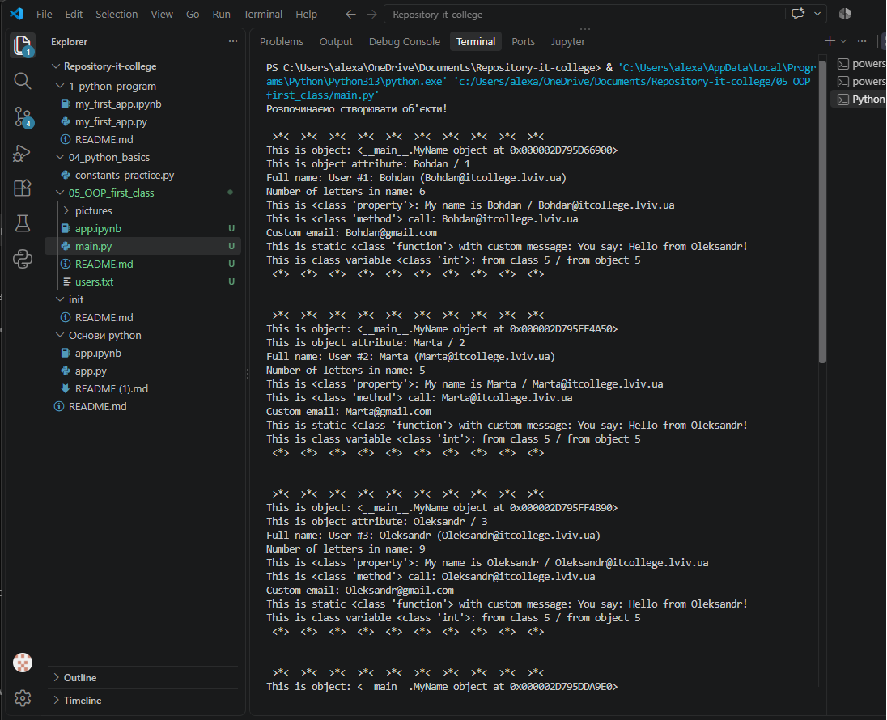

# Звіт до лабораторної роботи

## Тема: Знайомство з ООП у Python

### Мета роботи
Навчитися використовувати основні принципи об'єктно-орієнтованого програмування, створювати класи та об'єкти, працювати з їхніми атрибутами, методами та властивостями.

---

### Виконання роботи

1. Створено файли `main.py` та `app.ipynb` для виконання завдань.
2. Розроблено клас `MyName`, який працює з іменами користувачів.
3. Додано власне ім'я Oleksandr до списку імен.
4. Реалізовано метод `count_letters()` для підрахунку кількості літер в імені.
5. Змінено метод `say_hello()` для виведення власного привітання.
6. Модифіковано конструктор `__init__`, щоб імена починалися з великої літери.
7. Додано можливість змінювати домен електронної пошти.
8. Реалізовано перевірку правильності введення імені за допомогою `ValueError`.
9. Додано властивість `full_name`, яка повертає інформацію про користувача.
10. Створено метод `save_to_file()` для запису інформації у файл `users.txt`.
11. У Jupyter Notebook створено приклад класу `Student`.

### Результат виконання програми

### Результати виконання

Програма успішно створила об'єкти класу `MyName`, вивела інформацію про користувачів, їхні імена, електронні адреси та кількість літер.

Кількість імен у списку: 4.

Загальна кількість створених об'єктів: 5.

Перевірка неправильного імені показала повідомлення:

`Validation error: Ім'я може містити лише літери!`

Інформацію про користувачів збережено у файл `users.txt`.

### Відповіді на контрольні запитання

**1. Чому при передачі None створюється Anonymous?**

Тому що конструктор перевіряє значення імені. Якщо воно дорівнює `None`, викликається метод `anonymous_user()`, який створює користувача з іменем Anonymous.

**2. Як змінити текст привітання?**

Потрібно передати власний текст у метод `say_hello()`, наприклад:

`me.say_hello("Hello from Oleksandr!")`

**3. Як порахувати кількість літер імені?**

За допомогою функції `len(self.name)`.

**4. Чому кількість імен і об'єктів відрізняється?**

У списку міститься 4 значення, але створено 5 об'єктів, оскільки при обробці `None` додатково створюється об'єкт Anonymous.

**5. Як зробити першу літеру великою?**

За допомогою методу `capitalize()`.

**6. Як змінити домен електронної пошти?**

Передати інший домен у метод `create_email()`, наприклад `gmail.com`.

**7. Як перевірити правильність імені?**

Використати метод `isalpha()`. Якщо ім'я містить цифри або сторонні символи, викликати `ValueError`.

**8. Для чого потрібна властивість full_name?**

Вона повертає ідентифікатор користувача, ім'я та електронну адресу в одному рядку.

**9. Для чого потрібен метод save_to_file()?**

Він записує інформацію про користувача у текстовий файл.

---

### Висновок

Під час лабораторної роботи я ознайомився з основами об'єктно-орієнтованого програмування у Python. Навчився створювати класи та об'єкти, використовувати кон